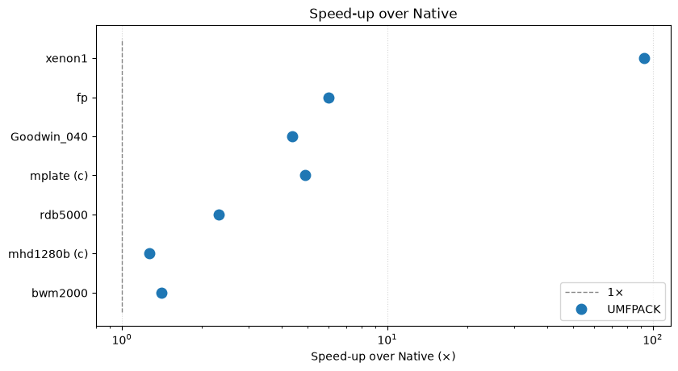

# algebra_linear - Pure-Rust BLAS, LAPACK, sparse LU, and AMG

<p align="left">
  <br>
  <sub>Compiles for <code>wasm32-unknown-unknown</code> and <code>wasm32-wasip1</code></sub>
</p>

No external library, no C in a normal build, nothing to link — it compiles for any
target, including `wasm32-unknown-unknown`.

## What is here

| module | contents |
|---|---|
| `blas` | level 1–3: `dgemm` (+`tn`/`nt`/`tt`), `dgemv` (+trans), `ddot`, `dnrm2`, `dasum`, `idamax`, `daxpy`, `dlange`, `dger`, `dsyrk`, `dtrsv` (+transpose), `dtrsm`, and the complex twins `zgemm` (+transposes), `zgemv` (+trans), `zger`, `zherk`, `zsyrk`, `zaxpy`, `zscal`, `ztrsv` (+transpose), `ztrsm`, `dznrm2` |
| `lapack` | drivers: `dgesv`, `dgetrf`, `dgetrf_rect` (the `nrows x ncols` panel), `dgetri`, `dpotrf`, `dsyev`, `dgesvd`, `dgeev` (+left vectors), `dggev`, and the complex `zgesv`, `zgetrf`, `zgetrf_rect`, `zgetri`, `zpotrf`, `zheev`, `zgeev`, `zgesvd`, `zggev`, plus the auxiliary routines; the `TESTING/LIN` accuracy checkers and the `TESTING/MATGEN` families are test-only and are not compiled into the crate |
| `sparse` | a simplicial* sparse LU (`CscView`, `SymbolicLu`, `LuFactors`) and a supernodal* one (`SymbolicSupernodal`, `SupernodalLu`) in CSC form, with real and complex scalars, plus the ported COLAMD ordering; `LuSymbolic`/`LuMethod` choose between the methods [*ported from faer -- see also reference #1](https://codeberg.org/sarah-quinones/faer) |
| `sparse::amgcl` | real `f64` CSR matrices, classical Ruge–Stüben and aggregation-based AMG, Gauss–Seidel, damped Jacobi, ILU(0), Chebyshev, SPAI(0/1), AMG-preconditioned CG, BiCGStab, restarted GMRES, and optional native scoped-thread parallelism |

Not every BLAS or LAPACK routine is here: the port covers the drivers a dense
linear-algebra caller needs, sparse LU with a COLAMD ordering, and the core CPU
AMGCL algorithms. Each function names the reference source it follows (for example
"transcription of `dsytrd`/`dlatrd`") so it can be checked against LAPACK 3.12.1.

## Conventions

- **Column-major**, so element `(i, j)` of an `nrow`-row matrix is `data[i + j * nrow]`.
- **0-based indices** and `usize` lengths, unlike the Fortran the routines are derived
  from.
- **No workspace arguments.** The workspace a Fortran routine asks the caller for is
  allocated internally here.
- **Solver-specific sparse formats.** Sparse LU callers provide CSC; AMGCL callers
  provide CSR. The crate does not convert between CSC and CSR.
- Functions return `Result<(), LapackError>` rather than LAPACK's `INFO`, with
  `INFO < 0` mapped to `BadShape` and `INFO > 0` to `Singular` or `Convergence`.
- An AVX2+FMA micro-kernel is selected at run time on x86-64; every other target
  (including `wasm32`) takes the portable blocked kernel.

## AMG and Krylov solvers

The `sparse::amgcl` module accepts user-supplied CSR matrices directly. This
example builds a two-dimensional Poisson matrix and solves it with
AMG-preconditioned CG:

```rust
use algebra_linear::sparse::amgcl::{Amg, AmgParams, Cg, CsrMatrix, SolverParams};

fn main() -> Result<(), algebra_linear::sparse::amgcl::Error> {
    let a = CsrMatrix::poisson_2d(32, 32)?;
    let b = vec![1.0; a.nrows()];
    let mut x = vec![0.0; a.nrows()];
    let mut amg = Amg::new(&a, AmgParams::default())?;
    let cg = Cg::new(SolverParams {
        tolerance: 1e-10,
        max_iterations: 100,
        ..SolverParams::default()
    });
    let report = cg.solve(&a, &mut amg, &b, &mut x)?;
    assert!(report.converged);
    println!("{} iterations", report.iterations);
    Ok(())
}
```

Execution is serial by default. On native targets, set `Parallelism` independently
in `AmgParams` and `SolverParams` to enable standard-library scoped threads. There
is no persistent worker pool or external runtime. WebAssembly always uses the
serial path. Gauss–Seidel, ILU(0) factorization and triangular solves, dense
coarse LU, and sequential coarsening steps remain serial.

Run the examples with:

```bash
cargo run --release --example amgcl_poisson -- 32
cargo run --release --example amgcl_aggregation
cargo run --release --example amgcl_smoothers
cargo run --release --example amgcl_nonsymmetric
cargo run --release --example amgcl_parallel -- 4
```

The module is a scoped core-CPU port, not complete feature-for-feature AMGCL
parity. MPI, GPU backends, block and complex values, user-supplied near-nullspace
vectors, and upstream C++ API compatibility are outside its scope. See
[`AMGCL_PORTING.md`](AMGCL_PORTING.md) for the source map and numerical notes.

## Performance

The `Native` solver of [`russell_sparse`](https://crates.io/crates/russell_sparse) uses the sparse LU from this crate. The table below compares it with UMFPACK on the benchmark matrices that completed; the data is from [benchmark-russell](https://github.com/cpmech/benchmark-russell).

| Matrix | NROW | NNZ | Native | UMFPACK | UMFPACK / Native |
| --- | ---: | ---: | ---: | ---: | ---: |
| bwm2000 | 2,000 | 7,996 | 1.11 ms | 0.750 ms | 1.47× faster |
| mhd1280b (c) | 1,280 | 22,778 | 0.717 ms | 0.383 ms | 1.87× faster |
| rdb5000 | 5,000 | 29,600 | 39.0 ms | 13.6 ms | 2.88× faster |
| mplate (c) | 5,962 | 142,190 | 3.13 s | 627 ms | 4.99× faster |
| Goodwin_040 | 17,922 | 561,677 | 449 ms | 107 ms | 4.19× faster |
| fp | 7,548 | 848,553 | 904 ms | 154 ms | 5.85× faster |
| xenon1 | 48,600 | 1,181,120 | 55.2 s | 598 ms | 92× faster |

`(c)` marks a complex-valued matrix; rows are sorted by NNZ. **NNZ is the matrix-file non-zero count.** Times are five-run averages from the benchmark on the benchmark machine (Arch Linux, Intel Core i9-13900KF).

The Native solver is fast on small systems: up to about 30,000 non-zeros it takes at most a few tens of milliseconds. It becomes very slow for matrices with more than **1 million** non-zeros: the `xenon1` case (NROW=48,600, 1,181,120 non-zeros) takes **55 s**, and the next real case (`twotone`, NROW=120,750, 1,224,224 non-zeros) did not finish within the 3-minute probe. For matrices with more than **1 million** non-zeros, expect **nearly a minute** or more.

The threshold is not a function of NNZ alone. The complex `mplate` (NROW=5,962, 142,190 non-zeros) takes **3.13 s**, and `RFdevice` (NROW=74,104, 365,580 non-zeros) did not finish in **15 minutes**; sparsity structure and numerical type matter as much as the non-zero count.

UMFPACK is faster than the Native solver on every matrix in the table; the gap grows with the fill-in, reaching **92×** on `xenon1`. The figure below shows the same ratios on a log scale (the dashed line is 1×):



## Tests

```bash
cargo test                      # the kernels against closed-form results and invariants
```

The reference-parity harness is development-only and lives behind a feature: it
compiles `c_code/reference_lapack.c` against a locally built LAPACK 3.12.1 and
compares the kernels against it.

```bash
ALGEBRA_LINEAR_DEV_LAPACK_ROOT=/path/to/lapack/build \
  cargo test --features dev_lapack            # the same, plus the parity tests
```

Do not reach for `--all-features` here: `dev_lapack` is the only feature, so it
selects the harness, which cannot build without a local LAPACK.

`ALGEBRA_LINEAR_DEV_LAPACK_ROOT` must be a CMake build directory holding
`include/lapack.h` and `lib/liblapack.so`. There is no default: recording one would
put a developer's directory layout into released source.

## License

BSD 3-Clause. The dense kernels are based on LAPACK 3.12.1 and BLAS. Their licenses are in the [`LICENSE`](LICENSE) file. The sparse LU and its COLAMD ordering are based on [faer](https://codeberg.org/sarah-quinones/faer) (MIT) and SuiteSparse COLAMD (BSD 3-Clause). The `sparse::amgcl` module follows [AMGCL](https://github.com/ddemidov/amgcl) (MIT). Their notices are also in the license file. The Rust code is by Dorival Pedroso. If you share a binary that statically links this crate, you must include the [`LICENSE`](LICENSE) file (BSD 3-Clause, clause 2).

## References

1. Kazdadi, S. Q. E., (2026). faer: A linear algebra library for the Rust programming language. Journal of Open Source Software, 11(123), 6099, https://doi.org/10.21105/joss.06099
