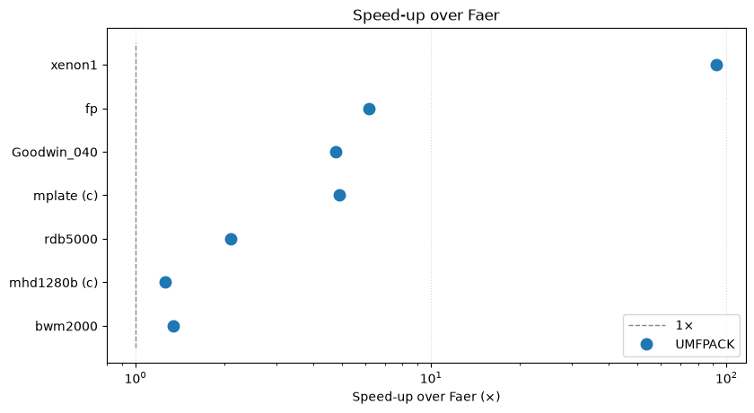

# algebra_linear - Pure-Rust BLAS, LAPACK, and sparse LU

<p align="left">
  <br>
  <sub>Compiles for <code>wasm32-unknown-unknown</code> and <code>wasm32-wasip1</code></sub>
</p>

No external library, no C in a normal build, nothing to link — it compiles for any
target, including `wasm32-unknown-unknown`.

## What is here

| module | contents |
|---|---|
| `blas` | level 1–3: `dgemm` (+`tn`/`nt`/`tt`), `dgemv` (+trans), `ddot`, `dnrm2`, `dasum`, `idamax`, `daxpy`, `dlange`, `dger`, `dsyrk`, `dtrsv` (+transpose), `dtrsm`, and the complex twins `zgemm` (+transposes), `zgemv` (+trans), `zger`, `zherk`, `zsyrk`, `zaxpy`, `zscal`, `ztrsv` (+transpose), `ztrsm`, `dznrm2` |
| `lapack` | drivers: `dgesv`, `dgetrf`, `dgetrf_rect` (the `nrows x ncols` panel), `dgetri`, `dpotrf`, `dsyev`, `dgesvd`, `dgeev` (+left vectors), `dggev`, and the complex `zgesv`, `zgetrf`, `zgetrf_rect`, `zgetri`, `zpotrf`, `zheev`, `zgeev`, `zgesvd`, `zggev`, plus the auxiliary routines; the `TESTING/LIN` accuracy checkers and the `TESTING/MATGEN` families are test-only and are not compiled into the crate |
| `sparse::faer` | `SparseLu`, an opaque sparse LU over caller-owned CSC arrays, with `LuMethod` choosing the simplicial or supernodal factorization, `EffectiveLuMethod` and `flop_ratio` reporting what `analyze` selected, one analysis reused across value updates, `SparseLuStats` reporting structure, method, proxy, cost and timing, real (`f64`) and complex (`Complex64`) scalars, and the COLAMD ordering |

- `sparse::faer` (the sparse LU and its COLAMD ordering) is ported from [faer](https://codeberg.org/sarah-quinones/faer) (MIT License)

Not every BLAS or LAPACK routine is here: the port covers the drivers a dense
linear-algebra caller needs and sparse LU with a COLAMD ordering. Each function names the reference source it follows (for example
"transcription of `dsytrd`/`dlatrd`") so it can be checked against LAPACK 3.12.1.

## Conventions

- **Column-major**, so element `(i, j)` of an `nrow`-row matrix is `data[i + j * nrow]`.
- **0-based indices** and `usize` lengths, unlike the Fortran the routines are derived
  from.
- **No workspace arguments.** The workspace a Fortran routine asks the caller for is
  allocated internally here.
- **Sparse format.** Sparse LU callers provide CSC. The crate does not convert between
  CSC and CSR.
- **Dense drivers** return `Result<(), LapackError>` rather than LAPACK's `INFO`, with
  `INFO < 0` mapped to `BadShape` and `INFO > 0` to `Singular` or `Convergence`. The sparse
  routines return `faer::Error`.
- An AVX2+FMA micro-kernel is selected at run time on x86-64; every other target
  (including `wasm32`) takes the portable blocked kernel.

## Sparse LU (`sparse::faer`)

`SparseLu` analyzes a compressed sparse column (CSC) pattern once and factorizes
new values on it; `LuMethod` chooses `Simplicial`, `Supernodal`, or `Auto { flop_ratio_threshold }`.
Immediately after `analyze`, `effective_method()` returns the chosen [`EffectiveLuMethod`](src/sparse/faer/solver.rs)
and `flop_ratio()` returns `Some(ratio)` when supernodal symbolic analysis ran (or `None` when
explicit `LuMethod::Simplicial` skipped it). `stats()` exposes `method`, `flop_ratio`, fill,
flop estimate, and timings after a factorization.

Note on the supernodal path: `SupernodalLu` (`src/sparse/faer/supernodal_lu.rs`) deliberately omits
contribution blocks between supernodes and updates each front by multiplying stored `L` and `U`
columns directly, which keeps bookkeeping simple at the cost of slower factorizations on large
fronts compared with upstream faer.

```rust
use algebra_linear::sparse::faer::{EffectiveLuMethod, LuMethod, SparseLu};

fn main() -> Result<(), algebra_linear::sparse::faer::Error> {
    // A = [4 1; 1 3] in CSC form.
    let col_ptr = [0, 2, 4];
    let row_idx = [0, 1, 0, 1];
    let values = [4.0, 1.0, 1.0, 3.0];

    let mut lu = SparseLu::analyze(&col_ptr, &row_idx, LuMethod::auto())?;
    assert_eq!(lu.effective_method(), EffectiveLuMethod::Simplicial);
    assert!(lu.flop_ratio().is_some());
    lu.factorize(&col_ptr, &row_idx, &values)?;

    let mut b = [1.0, 2.0];
    lu.solve(&mut b)?;
    assert!((b[0] - 1.0 / 11.0).abs() < 1e-14);
    assert!((b[1] - 7.0 / 11.0).abs() < 1e-14);

    // The same pattern with new values reuses the analysis.
    let new_values = [5.0, 2.0, 2.0, 2.0];
    lu.factorize(&col_ptr, &row_idx, &new_values)?;
    let mut b = [1.0, 1.0];
    lu.solve(&mut b)?;
    assert!((b[1] - 0.5).abs() < 1e-14);
    let stats = lu.stats().unwrap();
    assert!(stats.fill_ratio > 0.0);
    assert_eq!(stats.method, EffectiveLuMethod::Simplicial);
    Ok(())
}
```

## Performance

The `Faer` solver of [`russell_sparse`](https://crates.io/crates/russell_sparse) — `Genie::Faer`
from 5.5 (`Genie::Direct` in 5.0–5.4, `Native` in 4.x) — is the `sparse::faer` LU in this crate,
using the simplicial path (`LuMethod::Simplicial`) by default. Note that `SupernodalLu` omits
contribution blocks between supernodes and instead updates each front directly from the stored
`L` and `U` columns, so large fronts are slower than simplicial (and slower than upstream `faer`).
The table below compares the default simplicial path with UMFPACK on the SuiteSparse benchmark
matrices that completed; the data is from
[benchmark-russell](https://github.com/cpmech/benchmark-russell).

| Matrix | NROW | NNZ | Faer | UMFPACK | UMFPACK / Faer |
| --- | ---: | ---: | ---: | ---: | ---: |
| bwm2000 | 2,000 | 7,996 | 1.08 ms | 0.750 ms | 1.44× faster |
| mhd1280b (c) | 1,280 | 22,778 | 0.740 ms | 0.383 ms | 1.93× faster |
| rdb5000 | 5,000 | 29,600 | 35.2 ms | 13.6 ms | 2.59× faster |
| mplate (c) | 5,962 | 142,190 | 3.12 s | 627 ms | 4.97× faster |
| Goodwin_040 | 17,922 | 561,677 | 508 ms | 107 ms | 4.75× faster |
| fp | 7,548 | 848,553 | 942 ms | 154 ms | 6.10× faster |
| xenon1 | 48,600 | 1,181,120 | 55.0 s | 598 ms | 92× faster |

`(c)` marks a complex-valued matrix; rows are sorted by NNZ. **NNZ is the matrix-file non-zero count.** Times are outlier-free averages on the benchmark machine (Arch Linux, Intel Core i9-13900KF): 5 runs for UMFPACK, and for Faer 3 runs on the fast/medium matrices (`<= 30 s`) and 1 run on `xenon1`.

The kernel underneath matters most where the matrices are small, because the work per call stops
being the arithmetic. Two products carry an element-level computation, and both were measured on
that machine with the `bench_dgemm` and `bench_sparse_lu` tests of this crate
(`cargo test --release --lib bench_ -- --ignored --nocapture`):

| operation | before 2.1.1 | 2.1.1 |
| --- | ---: | ---: |
| `dgemm`, 3x8 by 8x3 (72 multiplications) | 8 600 ns | **60 ns** |
| `dgemm`, 24x24 by 24x24 | ~8.6 µs | **798 ns** (34.7 GFLOP/s) |
| `dgemm`, 500x500 by 500x500 | 6.36 ms | 6.33 ms (39.5 GFLOP/s) |
| sparse LU factorization, 192 dofs, fill 2.96 (simplicial) | 1.25 ms | **1.25 ms** |
| sparse LU factorization, same matrix (supernodal) | 2.99 ms | **0.60 ms** |

The 3x8 by 8x3 case is the Jacobian and gradient of a hex8 element: before 2.1.1 the blocked kernel
allocated its packing panels at the largest block on every call — 768 kB of zeroed memory for
seventy-two multiplications — and two of those per Gauss point made a `gemlab` element integral cost
138 µs. At 60 ns the same integral is 1.05 µs. Large products keep their throughput (the panels are
now sized by the block actually used); the small end is where the change is.

The Faer solver is fast on small systems: up to about 30,000 non-zeros it takes at most a few tens of milliseconds. It becomes very slow for matrices with more than **1 million** non-zeros: the `xenon1` case (NROW=48,600, 1,181,120 non-zeros) takes **55.0 s**, and matrices above 1.2 million pattern entries (starting with `twotone`, NROW=120,750, 1,224,224 non-zeros) are skipped by default in the benchmark harness. For matrices with more than **1 million** non-zeros, expect **nearly a minute** or more.

The threshold is not a function of NNZ alone. The complex `mplate` (NROW=5,962, 142,190 non-zeros) takes **3.12 s**, and `RFdevice` (NROW=74,104, 365,580 non-zeros) did not finish within the **3-minute** probe; sparsity structure and numerical type matter as much as the non-zero count.

UMFPACK is faster than the Faer solver on every matrix in the table; the gap grows with the fill-in, reaching **92×** on `xenon1`. The figure below shows the same ratios on a log scale (the dashed line is 1×):



## Tests

```bash
cargo test                      # the kernels against closed-form results and invariants
```

The reference-parity harness is development-only and lives behind a feature: it
compiles `c_code/reference_lapack.c` against a locally built LAPACK 3.12.1 and
compares the kernels against it.

```bash
ALGEBRA_LINEAR_DEV_LAPACK_ROOT=/path/to/lapack/build \
  cargo test --features dev_lapack            # the same, plus the parity tests
```

Do not reach for `--all-features` here: `dev_lapack` is the only feature, so it
selects the harness, which cannot build without a local LAPACK.

`ALGEBRA_LINEAR_DEV_LAPACK_ROOT` must be a CMake build directory holding
`include/lapack.h` and `lib/liblapack.so`. There is no default: recording one would
put a developer's directory layout into released source.

## License

`BSD-3-Clause`. The dense kernels are based on LAPACK 3.12.1 and BLAS (BSD 3-Clause). The sparse LU and its COLAMD ordering are based on [faer](https://codeberg.org/sarah-quinones/faer) (MIT) and SuiteSparse COLAMD (BSD 3-Clause). The notices are in the [`LICENSE`](LICENSE) file. The Rust code is by Dorival Pedroso. If you share a binary that statically links this crate, you must include the [`LICENSE`](LICENSE) file.
